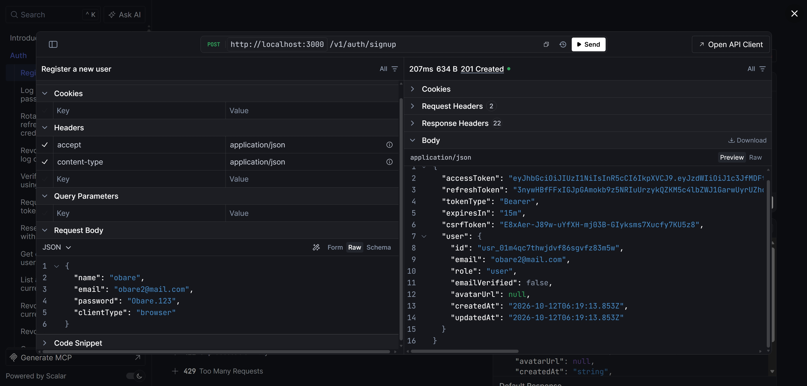
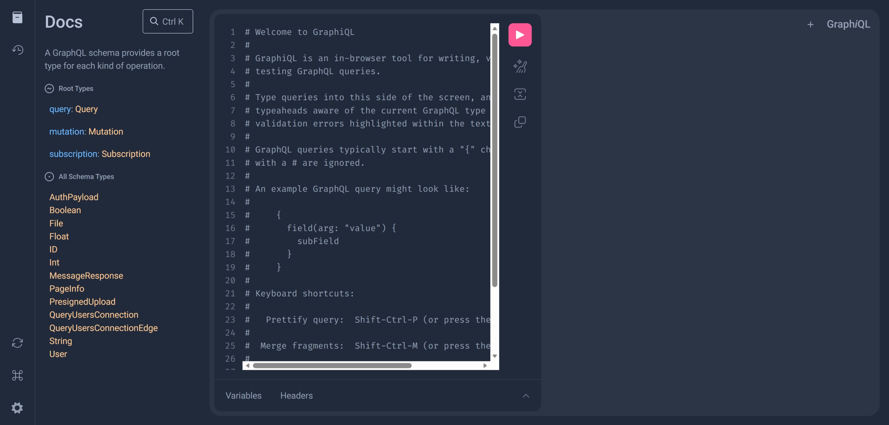

# Fastify Production-Grade Backend Template

[](https://github.com/organization/fastify-production-template/actions)
[](https://www.typescriptlang.org/)
[](https://nodejs.org/)
[](https://fastify.dev/)
[](https://orm.drizzle.team/)
[](https://scalar.com/)
[](https://mercurius.dev/)

A production-ready, enterprise-grade backend service template built with **Fastify 5**, **TypeScript Strict Mode** (`noUncheckedIndexedAccess`, `exactOptionalPropertyTypes`), **ESM**, **Drizzle ORM**, **PostgreSQL**, **Redis**, **BullMQ**, and dual **REST & GraphQL** API surfaces.

---

## Table of Contents
- [Architecture & Tech Stack](#architecture--tech-stack)
- [API Explorer Previews](#api-explorer-previews)
- [Project Structure](#project-structure)
- [Quick Start](#quick-start)
- [Available Scripts & Codegen Workflow](#available-scripts--codegen-workflow)
- [Dual API Surfaces (REST & GraphQL)](#dual-api-surfaces-rest--graphql)
- [Root-Anchored Subpath Imports](#root-anchored-subpath-imports)
- [API Documentation & Specifications](#api-documentation--specifications)
- [Multi-Mode Authentication & Security](#multi-mode-authentication--security)
  - [Auth Modes](#auth-modes)
  - [SSR Cookie-Forwarding Recipes](#ssr-cookie-forwarding-recipes)
- [Rate Limiting & Reverse Proxy (trustProxy)](#rate-limiting--reverse-proxy-trustproxy)
- [CORS Configuration & Production Safety](#cors-configuration--production-safety)
- [Storage & Direct-to-S3 Presigned Uploads](#storage--direct-to-s3-presigned-uploads)
- [TypeScript Client SDK (@app/sdk)](#typescript-client-sdk-appsdk)
- [Observability & Health Probes](#observability--health-probes)
- [Architecture Decision Records (ADRs)](#architecture-decision-records-adrs)
- [Testing & Quality](#testing--quality)
- [Deployment & DevOps](#deployment--devops)

---

## Architecture & Tech Stack

- **Runtime:** Node.js 22 LTS (ESM) with pnpm package manager.
- **Framework:** Fastify 5 with `fastify-type-provider-zod` for unified type-safety, validation, and serialization.
- **Database:** PostgreSQL 16 managed with Drizzle ORM and `drizzle-kit` SQL migrations.
- **Cache & Concurrency:** Redis (ioredis) backing distributed sliding-window rate limiting, progressive bans, and idempotency key locks.
- **Background Jobs:** BullMQ with a decoupled worker process, concurrency control, and dead-letter queues.
- **Dual Transport:**
  - **REST:** OpenAPI 3.1 compliant endpoints with interactive Scalar documentation (`/docs`).
  - **GraphQL:** Mercurius code-first engine powered by Pothos, batched DataLoader N+1 prevention, Relay cursor pagination, and Armor security rules.
- **Object Storage:** Pluggable S3-compatible provider (Supabase Storage, AWS S3, MinIO, Cloudflare R2) with direct-to-storage presigned uploads, server-side MIME sniffing, and local disk fallback.
- **Observability:** OpenTelemetry auto-instrumentation, Prometheus `/metrics` registry, structured Pino logging, and RFC-compliant liveness/readiness probes.
- **Client SDK:** Framework-agnostic TypeScript client (`@app/sdk`) built on standard `fetch` with single-flight refresh mutex and RFC 9457 typed error handling.

---

## API Explorer Previews

Explore the REST API with Scalar at `/docs` and the GraphQL schema with GraphiQL at `/graphiql`.

### REST API (Scalar)



### GraphQL (GraphiQL)



---

## Project Structure

```
├── packages/
│   └── sdk/                   # Framework-agnostic client SDK (@app/sdk)
│       ├── src/
│       │   ├── client.ts      # openapi-fetch wrapper with token refresh & retry backoff
│       │   ├── errors.ts      # Typed ApiError (RFC 9457 Problem Details)
│       │   ├── graphql.ts     # Precompiled operation documents & hash manifest
│       │   └── schema.d.ts    # Auto-generated TypeScript types from OpenAPI 3.1
│       └── package.json
├── src/
│   ├── app.ts                 # Fastify app factory (buildApp)
│   ├── server.ts              # HTTP server entrypoint with graceful shutdown
│   ├── worker.ts              # Background job worker entrypoint
│   ├── config/
│   │   └── env.ts             # Zod-validated environment configuration schema
│   ├── db/
│   │   ├── client.ts          # Postgres pool & Drizzle client
│   │   ├── schema.ts          # Relational tables, relations, and enums
│   │   └── seed.ts            # Database seed script
│   ├── graphql/
│   │   ├── builder.ts         # Pothos schema builder (Relay, DataLoader, ScopeAuth)
│   │   ├── loaders.ts         # Batched DataLoaders eliminating N+1 queries
│   │   ├── operations/        # Client GraphQL operations (.graphql)
│   │   ├── rules/security.ts  # Armor validation rules (depth, complexity, aliases)
│   │   ├── schema.ts          # Assembled GraphQL schema
│   │   └── types/             # Domain GraphQL types and resolvers
│   ├── jobs/
│   │   ├── queues.ts          # BullMQ queue declarations
│   │   └── processors/        # Email and file maintenance workers
│   ├── lib/
│   │   ├── crypto.ts          # Argon2id hashing, PKCE, and token generators
│   │   ├── errors.ts          # RFC 9457 Problem Details error classes & codes
│   │   ├── pagination.ts      # Opaque cursor pagination helpers
│   │   └── storage/           # S3 & LocalDisk storage providers
│   ├── modules/               # Domain modules (auth, files, health, users)
│   ├── observability/         # OpenTelemetry & Prometheus metrics
│   └── plugins/               # Fastify plugins (auth, cors, rate-limit, swagger)
├── scripts/
│   ├── generate-env.ts        # Auto-generates .env.example & docs/env-reference.md
│   ├── generate-graphql.ts    # Persisted queries allow-list & SDK operation generator
│   ├── generate-module.ts     # Module scaffolding CLI (REST + GraphQL + Tests)
│   ├── generate-openapi.ts    # Static openapi.json generator
│   ├── generate-schema.ts     # Deterministic schema.graphql generator
│   └── generate-sdk.ts        # Generates packages/sdk/src/schema.d.ts
├── docs/
│   ├── adr/                   # Architecture Decision Records
│   ├── images/                # REST and GraphQL API explorer screenshots
│   └── env-reference.md       # Auto-generated environment variables reference
├── test/                      # Vitest test suites (REST, GraphQL, SDK, storage, jobs)
├── Dockerfile                 # Multi-stage production container
└── docker-compose.yml         # Full local development stack
```

---

## Quick Start

### 1. Prerequisites
- Node.js `>= 22.0.0`
- pnpm `>= 10.0.0`
- Docker & Docker Compose

### 2. Installation & Environment
```bash
# Install dependencies
pnpm install

# Copy environment template
cp .env.example .env
```

### 3. Spin Up Infrastructure
```bash
# Use your locally installed PostgreSQL:
docker compose up -d redis mailpit

# Or use the Compose PostgreSQL container instead:
# docker compose up -d postgres redis mailpit
```

When running the `app` or `worker` Compose services, Compose reads `JWT_SECRET`,
`COOKIE_SECRET`, and S3 settings from `.env`. The PostgreSQL container uses
`POSTGRES_USER`, `POSTGRES_PASSWORD`, and `POSTGRES_DB` from `.env` when set;
its fallback credentials are for local development only.

### 4. Database Setup
```bash
pnpm db:migrate
pnpm db:seed
```

### 5. Run the Application
```bash
# Terminal 1: API Server (Hot reload)
pnpm dev

# Terminal 2: Background Worker (BullMQ)
pnpm dev:worker
```

- **Interactive API Docs:** `http://localhost:3000/docs`
- **GraphQL Playground:** `http://localhost:3000/graphiql`
- **Prometheus Metrics:** `http://localhost:3000/metrics`
- **Kubernetes Liveness:** `http://localhost:3000/health/live`
- **Kubernetes Readiness:** `http://localhost:3000/health/ready`

### Optional: S3-Compatible Object Storage

The Compose stack does not run an object-storage service or create buckets. Local development uses local disk storage by default. To use s3 Storage from the locally running API, create a bucket in provider and set the S3 credentials from your s3 project in `.env`:

```dotenv
STORAGE_DRIVER=s3
S3_ENDPOINT=<your-project-s3-endpoint>
S3_BUCKET=<your-storage-bucket>
S3_REGION=us-east-1
S3_ACCESS_KEY_ID=<your-s3-access-key>
S3_SECRET_ACCESS_KEY=<your-s3-secret-key>
S3_FORCE_PATH_STYLE=true
```

Keep the endpoint and credentials private; do not commit them. The Docker Compose `app` and `worker` services also read these S3 settings from `.env`, but you must run the provider and create its bucket separately.

MinIO is optional and is not included in Compose. To use it, run a MinIO-compatible server separately and point the same S3 settings at it. MinIO AIStor requires a license; see the [AIStor container guide](https://docs.min.io/aistor/installation/container/install/).

---

## Available Scripts & Codegen Workflow

The codebase strictly prevents schema, contract, and documentation drift.

| Command | Description |
|---|---|
| `pnpm dev` | Starts API server with hot reload |
| `pnpm dev:worker` | Starts BullMQ background worker in watch mode |
| `pnpm build` | Compiles application TypeScript into `dist/` |
| `pnpm build:sdk` | Compiles `@app/sdk` into `packages/sdk/dist/` |
| `pnpm typecheck` | Runs TypeScript compiler checks without emitting files |
| `pnpm lint` | Runs full linting suite (Biome + GraphQL descriptions + ESLint imports) |
| `pnpm lint:imports` | Enforces root-anchored imports and forbids parent/subfolder relative imports |
| `pnpm lint:docs` | Validates complete JSDoc documentation across project sources |
| `pnpm lint:fix` | Automatically formats and fixes Biome issues |
| `pnpm test` | Runs the full Vitest suite (109 tests across 23 files) |
| `pnpm test:cov` | Runs Vitest with v8 coverage |
| `pnpm gen:all` | Runs the full codegen pipeline (schema, openapi, env, errors, sdk, graphql) |
| `pnpm gen:schema` | Generates deterministically sorted `schema.graphql` |
| `pnpm gen:openapi` | Extracts routes into `openapi.json` |
| `pnpm gen:env` | Generates `.env.example` and `docs/env-reference.md` from Zod config |
| `pnpm gen:errors` | Generates RFC 9457 human-readable catalog `docs/error-codes.md` |
| `pnpm gen:sdk` | Generates TypeScript definitions in `packages/sdk` |
| `pnpm gen:graphql` | Generates persisted queries allow-list and SDK operations |
| `pnpm gen:module <name>` | Scaffolds a new domain module with REST, GraphQL, and tests |

---

## Adding a REST Endpoint: Posts Example

The module generator creates starter files, but it does not add a database
table, implement a database repository, or register the new routes. This
walkthrough shows the steps to make the generated Posts endpoints appear in
Scalar and work with PostgreSQL.

### 1. Generate the module

```bash
pnpm gen:module posts
```

Review the generated files under `src/modules/posts/`. The generated
`schemas.ts` defines request and response validation. The generated
`repository.ts` defines the `PostRepository` interface, and `routes.ts`
exports `createPostsRoutes(repo)`. The repository interface is only a
contract; it needs a database-backed implementation.

For example, define the request schema in `src/modules/posts/schemas.ts` with
Zod. Fastify uses it to validate the body and publish the request shape in
OpenAPI:

```ts
export const createPostRequestSchema = z.object({
  title: z.string().trim().min(1).max(255),
  content: z.string().max(10_000).optional(),
});
```

### 2. Add the Drizzle table

In `src/db/schema.ts`, add a table definition. The following example stores a
post's title and optional content, associates it with a user, and supports
soft deletion:

```ts
export const posts = pgTable(
  'posts',
  {
    id: varchar('id', { length: 36 }).primaryKey(),
    title: varchar('title', { length: 255 }).notNull(),
    content: text('content'),
    userId: varchar('user_id', { length: 36 })
      .notNull()
      .references(() => users.id, { onDelete: 'cascade' }),
    createdAt: timestamp('created_at', { withTimezone: true }).notNull().defaultNow(),
    updatedAt: timestamp('updated_at', { withTimezone: true }).notNull().defaultNow(),
    deletedAt: timestamp('deleted_at', { withTimezone: true }),
  },
  (table) => [
    index('posts_user_id_idx').on(table.userId),
    index('posts_deleted_at_idx').on(table.deletedAt),
  ]
);
```

Use the existing `pgTable`, `varchar`, `text`, `timestamp`, and `index`
imports in that file. Then generate and apply a migration so the table exists
in PostgreSQL:

```bash
pnpm db:generate
pnpm db:migrate
```

### 3. Implement the repository

In `src/modules/posts/repository.ts`, keep the generated interface and add a
class that implements it using Drizzle. Import `Database` from
`#src/db/client.js`, `posts` from `#src/db/schema.js`, and `and`, `eq`, and
`isNull` from `drizzle-orm`.

The repository class constructor stores the Drizzle client. For example,
`findById` should select a post that has not been soft-deleted:

```ts
constructor(private readonly db: Database) {}

async findById(id: string): Promise<PostRecord | null> {
  const [post] = await this.db
    .select()
    .from(posts)
    .where(and(eq(posts.id, id), isNull(posts.deletedAt)))
    .limit(1);

  return post ?? null;
}
```

Implement the other interface methods in the same class with Drizzle
`insert`, `update`, and `returning` queries. `create` inserts the post fields
and returns the new row. `update` updates the supplied fields and
`updatedAt`. `softDelete` sets `deletedAt` and `updatedAt`. Filter reads and
writes by `deletedAt IS NULL` so deleted posts are not returned or changed.

### 4. Build and register the route plugin

The generated `createPostsRoutes(repo)` factory expects a repository. In
`src/modules/posts/routes.ts`, add a Fastify plugin that creates the Drizzle
repository from the database decorator and registers the generated routes:

```ts
import type { FastifyPluginAsyncZod } from 'fastify-type-provider-zod';
import { DrizzlePostsRepository } from './repository.js';

export const postsRoutes: FastifyPluginAsyncZod = async (app) => {
  if (!app.db?.client) {
    throw new Error('Database client must be registered before posts routes');
  }

  const repo = new DrizzlePostsRepository(app.db.client);
  await app.register(createPostsRoutes(repo));
};
```

Keep the existing `createPostsRoutes` export and add the `postsRoutes` plugin
alongside it. In `src/app.ts`, import `postsRoutes` and register it with the
other REST modules inside the `env.REST_ENABLED` block:

```ts
app.register(postsRoutes, { prefix: env.API_PREFIX });
```

The prefix defaults to `/v1`, so the generated routes will be
`GET /v1/posts/:id` and `POST /v1/posts`. The POST route requires
authentication; send a bearer access token in the `Authorization` header.

### 5. Verify the endpoint and docs

Restart the API after registering the route. Open `http://localhost:3000/docs`
and look for the **Posts** tag. You can also inspect
`http://localhost:3000/openapi.json`. The route's Fastify `schema` metadata
provides the OpenAPI tag, summary, parameters, request body, and responses.

Run the relevant checks after implementation:

```bash
pnpm typecheck
pnpm test -- test/modules/posts.test.ts
```

Add route tests for the HTTP behavior as well as the generated service tests.
If you add GraphQL fields for Posts, wire their resolvers to the same service
and regenerate `schema.graphql` with `pnpm gen:schema`.

---

## Dual API Surfaces (REST & GraphQL)

Both REST and GraphQL interfaces share identical underlying business services, authentication decorators, and stable error codes (`RFC 9457` Problem Details):

```
Client Request
      │
      ├──> REST: /v1/* (Fastify Router + Zod Validation)
      │         │
      │         ▼
      │    Service Layer (AuthService, UsersService, FilesService)
      │         │
      └──> GraphQL: /graphql (Mercurius + Pothos Resolvers)
```

### Wire Conventions
- **JSON Only:** CamelCase fields, string IDs, ISO 8601 UTC timestamps (`2026-10-11T12:00:00.000Z`).
- **Cursor Pagination:** Base64 opaque cursor containing `id` and sorting keys (`decodeCursor`, `encodeCursor`).
- **Fieldsets:** Partial field filtering supported on REST via `?fields=id,email` and natively in GraphQL.
- **Traceparent:** OpenTelemetry `traceparent` headers forwarded across both protocols.

---

## Root-Anchored Subpath Imports

The codebase strictly enforces clean import boundaries using native Node.js Subpath Imports (`#src/*`, `#test/*`, `#packages/*`), completely eliminating fragile `../` traversals ([ADR 007](docs/adr/007-root-anchored-subpath-imports.md)):

### Rules & Conventions
- **Allowed:**
  - Same-folder relative imports: `import { AuthService } from './service.js';`
  - Cross-folder root-anchored imports: `import { createDbClient } from '#src/db/client.js';`
- **Forbidden:**
  - Any path containing `../` (e.g. `../../lib/errors.js`).
  - Any `./` path reaching into a subfolder (e.g. `./modules/auth/service.js`).
  - Root-anchored imports targeting files in the same directory (must use `./file.js`).
- **Runtime Resolution:**
  - In development and tests, Node.js and TypeScript resolve `#src/*` to `./src/*`.
  - In production Docker containers, `NODE_OPTIONS="--conditions=production"` resolves `#src/*` directly to `./dist/src/*` without extra bundlers or runtime path rewriting.
- **Enforcement:**
  - Enforced in CI via `pnpm lint:imports` using a custom ESLint AST rule (`custom-imports/root-anchored`).

---

## API Documentation & Specifications

The API provides comprehensive, zero-drift interactive and machine-readable documentation:

### Endpoints
- **Interactive REST Docs:** `/docs` (Scalar interactive UI by default with dark/light themes, searchable operations, and code snippets for `curl`, `fetch`, and `@app/sdk`; toggleable to Swagger UI via `DOCS_UI=swagger`).
- **Raw OpenAPI 3.1 Spec:** `/openapi.json` and `/openapi.yaml`.
- **GraphQL Schema SDL:** `/schema.graphql` (when `DOCS_EXPOSE_SCHEMA=true`).
- **GraphQL Explorer / GraphiQL:** `/graphiql` (and `/graphql` browser redirect outside production).
- **Documentation Hub:** `/docs/overview` (single-page dashboard linking REST docs, GraphQL playground, SDK, and error catalogs).

### Strict Schema Guarantees & Features
- **Zero Drift:** The OpenAPI 3.1 specification is derived directly from Fastify route schemas and Zod type providers via `@fastify/swagger` and `fastify-type-provider-zod`.
- **Complete Route Metadata:** Every endpoint declares `tags`, `summary`, `description`, `security`, request schemas, and typed responses.
- **Uniform Error Details:** All standard error statuses (400, 401, 403, 404, 409, 422, 429, 500) are mapped to reusable RFC 9457 `ProblemDetails` schemas with concrete example payloads.
- **Reusable OpenAPI Components:** Rate limit response headers (`RateLimit-Limit`, `RateLimit-Remaining`, `RateLimit-Reset`, `Retry-After`), pagination query parameters (`cursor`, `limit`), `?fields`, `?include`, `Idempotency-Key`, and deprecation headers (`Deprecation`, `Sunset`).
- **Auth Schemes:** `bearerAuth`, `cookieAuth`, and `apiKeyAuth` are fully declared in OpenAPI security schemes for interactive try-it-out.
- **GraphQL Documentation Quality:** Every GraphQL type, field, argument, and enum value is documented with descriptions, strictly enforced in CI via `pnpm lint` (`scripts/lint-graphql-descriptions.ts`).

### Production Security Controls
- **`DOCS_ENABLED`:** Enabled (`true`) in development and test; disabled (`false`) in production by default.
- **Basic Auth Protection:** Optional `DOCS_BASIC_AUTH_USER` and `DOCS_BASIC_AUTH_PASSWORD` protect `/docs*`, `/openapi.*`, `/schema.graphql`, and `/docs/overview` in staging or protected production environments.
- **Overhead & Noise Protection:** Documentation routes are automatically excluded from rate limiting, OpenTelemetry tracing noise, and Prometheus metrics, while maintaining relaxed Content Security Policy (CSP) solely for UI assets.

---

## Multi-Mode Authentication & Security

### Auth Modes
The authentication engine (`src/plugins/auth.ts`) evaluates credentials in the following order:

1. **Scoped API Key (`x-api-key: app_...`)**:
   - SHA-256 hashed and matched against the database.
   - Enforces granular scopes (e.g. `read:users`, `write:files`).
2. **Bearer JWT (`Authorization: Bearer <token>`)**:
   - Standard RFC 6750 access token (15-minute expiration).
3. **httpOnly Cookie Session (`access_token`)**:
   - Secure, `SameSite=Lax`, signed cookie session.
   - **Double-Submit CSRF Protection:** State-mutating methods (`POST`, `PUT`, `PATCH`, `DELETE`) require an `x-csrf-token` header matching the client's readable `csrf_token` cookie.
4. **Session Management & Token Rotation**:
   - Refresh tokens are rotated on each use. If reuse of a rotated refresh token is detected, the entire token family is immediately revoked.
   - Active sessions can be queried via `GET /v1/auth/sessions` and terminated via `DELETE /v1/auth/sessions/:id`.

### SSR Cookie-Forwarding Recipes

When using Server-Side Rendering frameworks, browser cookies must be forwarded to the API server during SSR fetches.

#### Next.js (App Router Server Component)
```typescript
import { cookies } from 'next/headers';
import { createApiClient } from '@app/sdk';

export async function getProfile() {
  const cookieStore = await cookies();
  const cookieHeader = cookieStore.toString();

  const client = createApiClient({
    baseUrl: process.env.API_BASE_URL!,
    headers: {
      cookie: cookieHeader,
    },
  });

  const { data, error } = await client.GET('/v1/users/me');
  if (error) throw new Error(error.detail);
  return data;
}
```

#### Nuxt 3 (Server Engine / useFetch)
```typescript
export default defineNuxtRouteMiddleware(async () => {
  const reqHeaders = useRequestHeaders(['cookie']);
  const client = createApiClient({
    baseUrl: useRuntimeConfig().public.apiBaseUrl,
    headers: reqHeaders as Record<string, string>,
  });
  
  const { data } = await client.GET('/v1/users/me');
  useState('user', () => data);
});
```

#### SvelteKit (`hooks.server.ts`)
```typescript
import type { Handle } from '@sveltejs/kit';
import { createApiClient } from '@app/sdk';

export const handle: Handle = async ({ event, resolve }) => {
  const cookieHeader = event.request.headers.get('cookie') || '';
  event.locals.api = createApiClient({
    baseUrl: process.env.API_BASE_URL!,
    headers: { cookie: cookieHeader },
  });

  return resolve(event);
};
```

---

## Rate Limiting & Reverse Proxy (trustProxy)

### Rate Limit Tiers
Configured in `src/plugins/rate-limit.ts` using Redis sliding window counters:

| Tier | Window | Max Requests | Applicable Routes |
|---|---|---|---|
| **Public** | 1 minute | 100 req | Public reads (`GET /v1/users`, `/v1/health`) |
| **Authenticated** | 1 minute | 300 req | User sessions & API keys |
| **Sensitive** | 1 minute | 10 req | `POST /v1/auth/login`, `POST /v1/auth/signup`, password resets |
| **Progressive Ban** | Variable | 0 (Banned) | Repeat offenders (15 min -> 1 hr -> 24 hr ban) |

### Fail-Open vs Fail-Closed
- **Fail-Open:** Public informational routes permit traffic if Redis goes down, preventing cascading outages.
- **Fail-Closed:** Security-sensitive routes reject traffic (`HTTP 503`) if Redis is unavailable, guaranteeing brute-force protection.

### Reverse Proxy (`trustProxy`) Setup
When running behind Nginx, AWS ALB, Cloudflare, or Kubernetes Ingress, configure `TRUST_PROXY`:

```bash
# In production .env
TRUST_PROXY=10.0.0.0/8,172.16.0.0/12,192.168.0.0/16
```

> [!WARNING]
> Never set `TRUST_PROXY=true` unconditionally in internet-facing environments without a trusted upstream proxy, as malicious clients can spoof `X-Forwarded-For` headers to bypass rate limits.

---

## CORS Configuration & Production Safety

Configured via `src/plugins/cors.ts`:

| Environment Variable | Description | Default |
|---|---|---|
| `CORS_ORIGIN` | Comma-delimited list of allowed origins, regexes, or wildcards | `http://localhost:3000,http://localhost:5173` |
| `CORS_CREDENTIALS` | Allow credentials (cookies & auth headers) | `true` |
| `CORS_MAX_AGE` | Preflight cache duration in seconds (`Access-Control-Max-Age`) | `86400` (24h) |

- **Boot Safety:** The server validates `CORS_ORIGIN` at boot time and throws an error if insecure wildcards (`*`) are used alongside `CORS_CREDENTIALS=true`.
- **Dynamic Origin Matching:** Supports domain wildcards (e.g. `https://*.example.com`).

---

## Storage & Direct-to-S3 Presigned Uploads

### Direct Upload Flow
To keep Node.js memory footprint low, file uploads bypass the application server:

1. **Request Upload:** Client calls `POST /v1/files/upload/request` with `{ filename, mimeType, size }`.
2. **Presigned URL:** Server verifies file size and MIME allow-list, creates a `pending` DB record, and returns a presigned PUT URL.
3. **Upload:** Client uploads directly to S3 / MinIO.
4. **Confirm Upload:** Client calls `POST /v1/files/upload/confirm` with `{ fileId }`.
   - The server verifies object existence via `HeadObject`.
   - **MIME Magic-Number Sniffing:** The server reads the initial bytes and inspects binary magic numbers via `file-type`. Spoofed files (e.g. an `.exe` disguised as `image/png`) are immediately deleted from storage and rejected.
5. **Streaming Fallback:** REST streaming fallback is available via `POST /v1/files/upload` for simple multipart clients.

---

## TypeScript Client SDK (@app/sdk)

The generated client SDK in `packages/sdk` is completely framework-agnostic and relies exclusively on standard Web APIs (`fetch`).

```typescript
import { createApiClient, ApiError } from '@app/sdk';

const client = createApiClient({
  baseUrl: 'https://api.example.com',
  getAccessToken: () => localStorage.getItem('token'),
  onRefreshToken: async () => {
    const res = await fetch('/refresh', { method: 'POST' });
    const { token } = await res.json();
    localStorage.setItem('token', token);
    return token;
  },
});

// Fully typed REST request
try {
  const { data, error } = await client.GET('/v1/users/{id}', {
    params: { path: { id: 'usr_01J...' } },
  });
} catch (err) {
  if (err instanceof ApiError) {
    console.error(err.code, err.status, err.invalidParams);
  }
}

// Typed GraphQL execution
const { data } = await client.graphql('{ me { id email } }');
```

---

## Observability & Health Probes

- **Metrics:** Prometheus registry at `/metrics` with Fastify request duration histograms, status code counters, and GraphQL operation durations.
- **Tracing:** OpenTelemetry NodeSDK auto-instrumenting HTTP, Postgres (`pg`), and Redis (`ioredis`).
- **Health Probes:**
  - `GET /health/live`: Fast liveness check.
  - `GET /health/ready`: Checks live connections to PostgreSQL, Redis, and Object Storage.

---

## Architecture Decision Records (ADRs)

Key architectural decisions are documented in [`docs/adr/`](file:///d:/Projects/2026/Fastify%20Projects/fastify-production-template/docs/adr/):
- [ADR 001: Mercurius with Pothos (Code-First GraphQL)](file:///d:/Projects/2026/Fastify%20Projects/fastify-production-template/docs/adr/001-mercurius-with-pothos.md)
- [ADR 002: Direct-to-Storage Presigned Uploads with MIME Sniffing](file:///d:/Projects/2026/Fastify%20Projects/fastify-production-template/docs/adr/002-direct-to-storage-presigned-uploads.md)
- [ADR 003: Cost-Based GraphQL Rate Limiting and Armor](file:///d:/Projects/2026/Fastify%20Projects/fastify-production-template/docs/adr/003-cost-based-graphql-rate-limiting-and-armor.md)
- [ADR 004: Redis Fail-Open vs Fail-Closed Strategy](file:///d:/Projects/2026/Fastify%20Projects/fastify-production-template/docs/adr/004-redis-fail-open-vs-fail-closed-strategy.md)
- [ADR 005: Multi-Mode Auth Core](file:///d:/Projects/2026/Fastify%20Projects/fastify-production-template/docs/adr/005-multi-mode-auth-core.md)
- [ADR 006: Framework-Agnostic Fetch SDK](file:///d:/Projects/2026/Fastify%20Projects/fastify-production-template/docs/adr/006-framework-agnostic-fetch-sdk.md)
- [ADR 007: Root-Anchored Subpath Imports with Same-Folder Relative Imports](file:///d:/Projects/2026/Fastify%20Projects/fastify-production-template/docs/adr/007-root-anchored-subpath-imports.md)

---

## Testing & Quality

```bash
# Run unit, integration, and contract tests
pnpm test

# Run tests with code coverage analysis
pnpm test:cov
```

All 98+ tests execute in hermetic environments using Testcontainers when Docker is available, or in-memory mocks when running in isolated test suites.

---

## License
MIT
